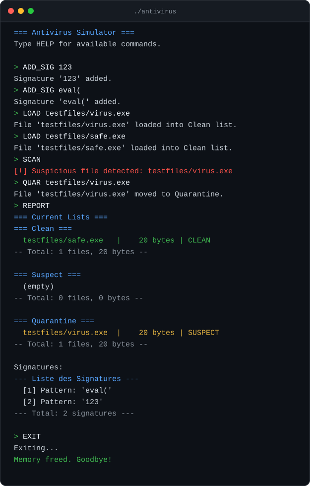

<div align="center">

# Antivirus Simulator

A signature-based file scanner in C that moves files between Clean, Suspect and Quarantine lists, built on hand-written linked lists.


<sub>Mini-project · C programming and data structures</sub>

[Commands](#commands) &nbsp;·&nbsp; [Example session](#example-session) &nbsp;·&nbsp; [Getting started](#getting-started)

</div>

## Overview

The simulator never touches real malware. It loads files from disk, searches their bytes for user-defined signature patterns, and moves any match to a Suspect list, from where it can be quarantined or restored. Each list is a linked list of file records, and all memory is managed by hand with `malloc` and `free`.

## Commands

| Command | Effect |
|---|---|
| `ADD_SIG <pattern>` | Add a signature |
| `DEL_SIG <pattern>` | Remove a signature |
| `LOAD <path>` | Load a file into the Clean list |
| `SCAN` | Scan the Clean list and move matches to Suspect |
| `QUAR <name>` | Move a file to Quarantine |
| `RESTORE <name>` | Move a file back to Clean |
| `REPORT` | Show every list, totals and the signatures |
| `PURGE` | Free all lists |
| `EXIT` | Quit and free memory |

## Example session



<sub>A real run against the files in `testfiles/`: `virus.exe` contains the signature `123` and is caught, then quarantined.</sub>

## Project structure

```
antivirus-simulator/
├── include/
│   ├── filelist.h   # File records and the Clean, Suspect and Quarantine lists
│   ├── siglist.h    # Signature list
│   ├── scan.h       # Pattern matching over file contents
│   └── cleanup.h    # Freeing everything
├── src/             # Implementations and the command loop in main.c
├── testfiles/       # Sample files to scan
└── Makefile
```

## Getting started

**Requirements**: GCC and Make.

```bash
make        # builds ./antivirus
make run    # builds and starts it
```

## Team

| Member | Part |
|---|---|
| Yassine | Data structures and prototypes |
| Merwa | File handling |
| Adam | Signature management |
| Malak | Scanning |
| Hamza | Cleanup |

## License

Released under the [MIT License](LICENSE).

---

<div align="center"><sub>Part of <a href="https://github.com/creepout777">Yassine Aitaouicha's projects</a></sub></div>
